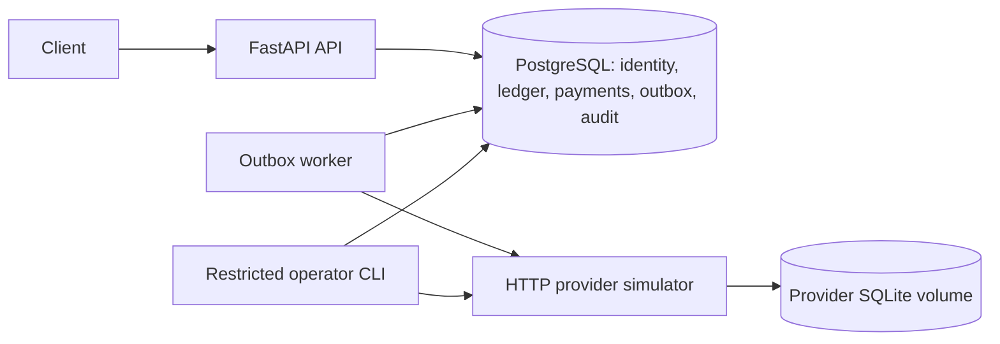

# Payment & Ledger System

A backend portfolio project demonstrating transactional money movement, PostgreSQL
invariants, idempotency and recovery from partial failures. Built with Python 3.14,
FastAPI, SQLAlchemy 2 and Alembic. All funds and the external provider are fictional.

Supports EUR, USD and JPY as integer minor units, without currency conversion.
This is not a payment processor or a Stripe clone.

## Project status

All six approved milestones are complete, approved and merged into `main`.
[M6 was merged in PR #4](https://github.com/WYLLLY/payment-ledger-system/pull/4).
The complete suite passes on the merged revision: **317 tests, 0 failed, 0 skipped**
(31 unit and 286 integration). [Verified main CI run](https://github.com/WYLLLY/payment-ledger-system/actions/runs/38442168726).

Start with the [portfolio case study](docs/portfolio-case-study.md) for the engineering
problem, design decisions and evidence. The [technical architecture](docs/architecture.md)
and [final verification record](docs/final-verification.md) provide implementation and
validation details. [Independent reviews](reviews/README.md) retain their original scope
and results.

## What it does

- Registration, Argon2id passwords, opaque hashed sessions, login/logout and ownership checks.
- One wallet per user/currency, each with an available and a reserved ledger account.
- Immutable double-entry journals and atomically maintained balances, enforced by PostgreSQL.
- Internal transfers with retained idempotency responses and deterministic account locking.
- Outgoing payments with atomic reservation/outbox creation, asynchronous execution and recovery.
- Persistent provider idempotency, bounded retries, lease generations and `needs_review`.
- Read-only internal/external reconciliation, restricted audited operator commands and runbooks.
- JSON logs, correlation IDs, internal operational metrics and PostgreSQL rate limiting.

## Architecture



The API and worker share one application and PostgreSQL database. SQLite belongs only
to the independently persistent provider simulator. No Redis, Kafka, microservices or
distributed transaction is needed. External HTTP calls occur after local transactions close.

A transfer commits its idempotency record, business operation, journal, balance changes,
audit and stored response together. A payment initially moves `available → reserved` and
creates its outbox task atomically. A worker later posts `reserved → clearing` on confirmed
success, or `reserved → available` on confirmed refusal. An unknown outcome keeps funds
reserved. A payment cannot have both a settlement and a release journal.

Read the [technical architecture](docs/architecture.md) for invariants, transaction
boundaries, state transitions and role privileges. The [approved plan](docs/approved-plan.md)
is the architectural source of truth; its original approved text is preserved.

## Install and run

Requirements: Python 3.14, uv 0.12.23, Docker Engine and Docker Compose v2 or later.
Use a dedicated development/test PostgreSQL cluster. Repository access is required.
Clone the completed project from `main`:

```sh
git clone --branch main https://github.com/WYLLLY/payment-ledger-system.git
cd payment-ledger-system
uv sync --frozen
python3 scripts/init_env.py
docker compose config --quiet
docker compose up --build --wait --wait-timeout 180
curl --fail http://127.0.0.1:8000/health/live
curl --fail http://127.0.0.1:8000/health/ready
```

`init_env.py` creates independent random secrets in an ignored, mode-0600 `.env` and
refuses to overwrite it. Do not copy placeholder credentials from `.env.example`.
Compose starts PostgreSQL, applies migrations using the separate migrator, provisions
restricted API/worker logins, then starts the API, worker and provider. PostgreSQL and
provider data use separate persistent volumes. Neither runtime receives migration secrets.

| Local interface | Address |
| --- | --- |
| API and OpenAPI UI | `http://127.0.0.1:8000/docs` |
| API liveness / readiness | `/health/live` / `/health/ready` |
| PostgreSQL | `127.0.0.1:15432` |
| Fictional provider | `http://127.0.0.1:8001` |

Readiness verifies schema objects and required runtime privileges, including M6 admission.
It returns 503 for an unavailable/incomplete database. The worker has no application
healthcheck; inspect its logs, outbox metrics and actual payment progress.

For an existing M4 environment, add the separate worker secret before upgrading:
`python3 scripts/init_env.py --add-worker-secret`. Normal startup migrates an existing
M5 database to M6; serialize migration execution. Changing `.env` alone does not rotate
passwords on an existing PostgreSQL volume.

Stop with `docker compose down`; data remains. `docker compose down --volumes` deletes
that Compose project's databases and is appropriate only for disposable verification data.
Do not delete volumes to recover a payment. On the development Mac, use the dedicated
profile: `colima start --profile payment-ledger --activate=false`, then
`DOCKER_CONTEXT=colima-payment-ledger docker-compose ...`.

## API contracts

| Area | Routes |
| --- | --- |
| Identity | `POST /auth/register`, `/auth/login`, `/auth/logout`; `GET /users/me` |
| Wallets | `POST /wallets`; `GET /wallets`, `/wallets/{id}`, `/wallets/{id}/ledger` |
| Transfers | `POST /transfers`; `GET /transfers`, `/transfers/{id}` |
| Payments | `POST /payments`; `GET /payments`, `/payments/{id}` |

Protected routes require `Authorization: Bearer <session-token>`. Foreign resources and
missing resources both return 404. The generated OpenAPI UI documents request schemas.

Financial POSTs require a 1–128 character visible-ASCII `Idempotency-Key`. Keys are scoped
by user and operation kind and retained with the canonical request hash and original
response. Same key/payload returns the original result; a changed payload returns 409.
Expected business rejections are retained too. Retry a lost response with the same key.

Amounts must be JSON integers in `1..1_000_000_000_000`; booleans, floats and numeric strings
are rejected. Transfers require distinct wallets with the same currency. Payment recipients
are fictional identifiers, not bank details. A new transfer returns 201; a new payment
returns 202 with `pending`. Replaying a payment returns its original 202 response even
if it has completed: use GET for current state.

Financial POST admission defaults to 60 requests per 60 seconds per authenticated user
and operation kind. Exhaustion returns 429 and `Retry-After`. Already committed keys
retain replay/conflict behavior at quota. Authentication has its own 20-per-60-second
counter per direct client IP. Configure bounded values using the `APP_*` variables in
`.env.example`. Forwarded headers are not trusted by the provided server commands.

## Development funding and verification

A new wallet starts at zero. There is no funding HTTP endpoint. Fixed opening fixtures
require an explicit dev/test opt-in and a separate restricted role; normal migrations
and demonstration startup do not grant funding capabilities to the API or worker.

```sh
# Dedicated dev/test environment only; supply DEMO_PASSWORD without committing it.
PAYMENT_LEDGER_DEV_FIXTURES=1 uv run --frozen python scripts/seed_demo.py
```

The fixed demo users receive EUR/USD/JPY wallets. Opening amounts are fixed by the
fixture function, and reruns do not duplicate funds. See the technical architecture
for the fixture privilege boundary. Never run funding fixtures on a demonstration deployment.

Run the complete maintained suite, including real PostgreSQL constraints, privileges,
migrations, concurrency, provider HTTP failures and crash recovery:

```sh
uv run --frozen ruff check .
uv run --frozen ruff format --check .
uv run --frozen mypy
uv run --frozen pytest
uv run --frozen python scripts/smoke_api.py
PAYMENT_LEDGER_DEV_FIXTURES=1 uv run --frozen python -m scripts.smoke_payments
```

Tests require the dedicated Compose database and `.env`. They create and remove their
own `payment_test_*` databases. Missing infrastructure is a failure, never a silent skip.
Smoke scripts use API port 8000 and leave fictional users/operations in the development
stack. The payment smoke explicitly provisions dev funding. Do not run these commands
against production or a shared demonstration cluster.

GitHub Actions uses the frozen lockfile, ephemeral credentials, fresh Compose volumes,
all unit/integration tests and both HTTP smoke flows. Optional local workflow checks:
`actionlint .github/workflows/ci.yml` and `shellcheck docker/init-db.sh`.

## Operations

Follow the [operations runbook](docs/operations-runbook.md) to provision the separate
operator login and use `metrics`, `reconcile`, `lookup` and `retry`. These tools have no
public HTTP endpoint. Operator scheduling is audited in the same transaction and cannot
steal an active lease, reset retries, force success or release an unresolved reservation.
Reconciliation detects discrepancies without repairing financial history.

API events use a validated/generated UUID `X-Request-ID`; financial audits retain it.
Worker/provider events use the immutable payment UUID. Logs exclude headers, bodies,
query strings and SQL exception text. Metrics cover pending payments, `needs_review`,
oldest incomplete outbox age and expired leases.

## Limitations

This is a fictional-money portfolio backend, not a production-certified payment service.
No real provider integration, refunds, currency exchange or callbacks are included.
Database administrators/migrators and runtime principals remain explicit trust boundaries.

Provider timeouts bound socket inactivity, not total response duration; a slow trickle
can delay processing beyond a lease while fencing protects financial effects. Unknown
outcomes after retry exhaustion remain reserved, with no force-release command.
External reconciliation is paginated observation rather than an atomic distributed snapshot.
The operator login is shared, with incident-ticket attribution. Fixed-window quotas allow
boundary bursts; no automatic retention cleanup, backup/restore validation, disk/power-loss
certification, production load qualification or dependency vulnerability audit is claimed.
Additional independent review probes are not all retained in CI; the maintained count
is 317, not the larger combined count from temporary review experiments.

## Documentation and source layout

- [Portfolio case study](docs/portfolio-case-study.md): engineering decisions, evidence and demo guide.
- [Technical architecture](docs/architecture.md): transactions, financial invariants and roles.
- [Operations runbook](docs/operations-runbook.md): diagnostics, incidents and safe recovery.
- [Final verification](docs/final-verification.md): clean install, checks and repository state.
- Milestone evidence: [M1](docs/milestone-1-verification.md), [M2](docs/milestone-2-verification.md),
  [M3](docs/milestone-3-verification.md), [M4](docs/milestone-4-verification.md),
  [M5](docs/milestone-5-verification.md), [M6](docs/milestone-6-verification.md).
- [Independent reviews](reviews/README.md): milestone and final audit reports, with historical test counts.

`src/payment_ledger/` contains the API, identity services, `ledger/`, `transfers/`,
`payments/` and `operations/`. Versioned schema/privileges live in `migrations/`;
local provisioning and smoke commands in `scripts/`; real PostgreSQL tests in
`tests/integration/`; isolated contracts in `tests/unit/`. `AGENTS.md` and repository
skills define the contribution workflow. No merge occurs without explicit authorization.
