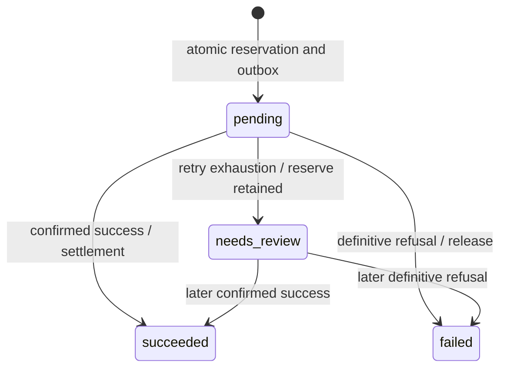

# Technical architecture

This document describes the implemented M1–M6 system. The original
[approved plan](approved-plan.md) remains authoritative; this is an English implementation
reference, not a revised architecture. Operational procedures are in the
[runbook](operations-runbook.md).

## Components and persistence

One Python application provides the FastAPI API, worker, ledger services and operator CLI.
SQLAlchemy uses psycopg with PostgreSQL 17 at READ COMMITTED; Alembic owns schema and ACLs.
The HTTP provider simulator runs separately to exercise the unreliable network boundary.
Its SQLite WAL database with FULL synchronization persists immutable outcomes independently
of PostgreSQL. No shared in-memory provider idempotency or distributed commit is assumed.

API/worker startup does not run migrations. A separate migration process applies revisions
0001–0006 and provisions credentials. Docker containers run application processes as a
non-root user. API, PostgreSQL and simulator bind to loopback on the host in Compose.

## Domain and database guarantees

| Object | Contract and protection |
| --- | --- |
| User/session | Argon2id passwords; cryptographically random opaque session tokens stored only as SHA-256 hashes; expiry/revocation checked on authenticated access. |
| Wallet | Unique `(user_id,currency)`; one available and one reserved account, protected by uniqueness, currency FK and deferred pair validation. |
| Ledger account | BIGINT minor units; user balances nonnegative; only per-currency funding/clearing system accounts may be negative. |
| Journal/entries | Exactly two distinct accounts, one currency, opposite nonzero amounts; deferred constraint triggers check completed journals; UPDATE/DELETE/TRUNCATE denied by privileges and mutation triggers. |
| Projection | Entry insertion applies the balance delta atomically; nonnegative checks and overflow abort the transaction. Reconciliation compares against authoritative entries. |
| Idempotency | Unique `(user_id,operation_kind,key)`; database-computed canonical SHA-256 request hash; immutable completed response and retained financial key. |
| Transfer | One journal; deferred operation/idempotency/account/amount consistency; immutable history. |
| Payment | Immutable identity; one reservation journal and at most one terminal journal through partial uniqueness; terminal state immutable; deferred phase/account/amount checks. |
| Outbox | One row per payment; bounded attempts, due time, lease expiry, monotonic generation and done flag. |
| Audit | Business transition audits commit with the operation. Operator events identify database `session_user`, incident reason and correlation, and reject mutation. |

Supported currencies are EUR, USD and JPY. Public amounts are strict integers from 1 to
1,000,000,000,000 minor units. No floating-point arithmetic represents money. Projection
balances use BIGINT; sums in reconciliation use PostgreSQL NUMERIC to avoid aggregate overflow.

## Transaction and lock boundaries

| Operation | Atomic database transaction | Outside the transaction |
| --- | --- | --- |
| Financial admission | UPSERT per-user/per-kind window counter; commits independently even if a later request fails. | Authentication/shape validation precedes admission; committed financial replays bypass quota. |
| Transfer | Claim idempotency, validate ownership/currency, create transfer, journal/entries/projections, audit, stored response. | No HTTP call. |
| Payment creation | Claim idempotency, create payment, reserve available→reserved, create outbox, audit, stored 202 response. | No provider contact. |
| Worker claim | Lock eligible outbox, payment; increment generation/attempts, set lease; transition exhausted work to needs_review when necessary. | Provider lookup first; bounded submission only after explicit absence for pending payments. |
| Worker finish | Lock outbox then payment; verify lease/generation; post terminal pair, set state/done, append audit. Unknown schedules another lookup and keeps reservation. | No provider contact. |
| Operator retry | Lock outbox; schedule due work only if no live lease; append immutable audit. | Worker performs actual recovery; operator never selects a financial outcome. |
| Operator lookup | Record lookup attempt before network I/O. | Provider query; interruption leaves audit and reservation intact. |
| Reconciliation | One statement/snapshot for internal invariants/metrics. Short independent reads for each external page and state recheck. | Provider lookups occur without a checked-out DB connection. No repair transaction. |

Financial paths lock idempotency/business rows before ledger accounts. Every monetary writer
acquires all participating account rows individually in ascending UUID order and re-reads
balances after waiting. Worker/ops paths consistently acquire outbox before payment; account
locks follow. `FOR UPDATE SKIP LOCKED` distributes work, while uniqueness, posting constraints,
leases and generations protect correctness. It is not by itself a double-payment guarantee.

Local deadlock/serialization aborts (`40P01`, `40001`) allow at most three attempts of the
entire local transaction. Connection loss or ambiguous commit is not blindly retried.
Clients replay using the same idempotency key; workers recover through durable outbox state.

## Payment lifecycle and external evidence

Timeout, 5xx, malformed/mismatched evidence and uncertain transport outcomes never mean
failure. The stable provider identity is `payment:<payment UUID>`. The simulator atomically
persists identity, canonical parameters and terminal result before responding and refuses
contradictions. A terminal response is accepted only if key, payment identity, amount,
currency and recipient all match.

At most five pending claims may submit, including claims lost to crashes. Subsequent
needs_review work only queries, approximately once per minute. It never resets the retry
budget or resubmits merely because the provider currently reports absence. Confirmed success
posts reserved→clearing; confirmed refusal posts reserved→available. Unknown keeps reserved
funds. A late worker cannot replace a newer generation or create a second terminal journal.

## Roles and privileges

| Principal | Granted responsibility | Explicit exclusions |
| --- | --- | --- |
| PostgreSQL administrator | Bootstrap/test-database management. | Not a runtime identity; outside the financial threat boundary. |
| `payment_migrator` | Own schema, migrations, safe credential provisioning. | Never passed to API/worker/operator runtime. |
| `payment_app` | Required identity/session columns and reads; wallet/transfer/payment functions and admission. | No direct ledger/balance/outbox writes, private posting helper or operator function. |
| `payment_worker` / `payment_worker_login` | Claim/finish functions; login inherits only restricted worker membership. | No direct financial DML, schema creation/DDL or operator commands; schema USAGE only. |
| `payment_operator` / `payment_operator_login` | Read diagnostics, audited lookup/retry function. | No finalization, budget reset, ledger mutation, session/password reads or worker/migrator escalation. |
| Optional `payment_dev` | Fixed dev/test opening function only after explicit fixture provisioning. | Absent from normal migration provisioning; no arbitrary amount or runtime funding grant. |

Functions use minimal EXECUTE grants, qualified object names and safe
`search_path=pg_catalog,pg_temp`. PUBLIC does not receive newly created function execution.
Existing privileged role attributes/memberships are rejected during provisioning. Role names
are cluster-wide, so use a dedicated cluster; downgrades retain roles to avoid disrupting
other databases. Runtime roles are trusted principals able to invoke granted operations;
this is not row-level authorization against a compromised API process. HTTP ownership checks
and database ownership validation both apply to normal operations.

## Fixtures, migrations and retained history

Fixed dev/test openings fund six demo wallets: EUR/USD 100,000 minor units and JPY 10,000
per user. The seed batch locks all accounts globally by UUID and uses a transaction advisory
lock, so retries cannot duplicate funds or deadlock through inconsistent per-wallet ordering.
Normal startup does not create demo accounts or enable funding in runtime roles.

Upgrade revisions preserve earlier financial history. Supported empty-history downgrades
are tested; populated ledger, transfers, payment/idempotency history and operator audit impose
explicit downgrade refusal where defined. M6 counters/correlation fields are removed on an
allowed M6 downgrade. Do not interpret downgrade as a production rollback strategy or delete
history to make it succeed. Serialize migration execution.

## Diagnostics and scope limits

Internal checks cover entry/projection differences, journal pairs, currency conservation,
negative user balances, payment phase accounts/amounts, reserved sums and outbox agreement.
External reports separate provider contradiction, unavailable evidence, unresolved reservation,
awaiting finalization and concurrent progress. New payments during pagination require a new
sweep. Metrics are internal CLI output, not an unauthenticated endpoint.

JSON events link API request UUIDs to audit resource IDs; worker/provider events use payment
UUIDs. A database trigger fills missing payment audit correlation on crash-exhaustion claims.
No raw headers, payloads, query strings or exception details are included in application events.
Native Uvicorn lifecycle/PostgreSQL logs retain their own formats.

The [runbook](operations-runbook.md) explains socket-inactivity timeout limits, shared
operator attribution and recovery after crashes. No real-provider guarantees, host-power-loss
or backup-restore qualification, sustained production-load result or dependency vulnerability
audit is claimed. Reconciliation detects discrepancies; it cannot protect against a privileged
administrator deliberately changing schema and must never silently rewrite financial history.
